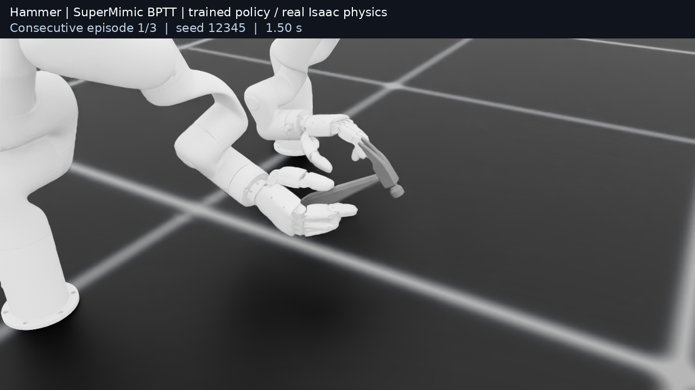

# Supermimic-dex

SuperMimic-style backpropagation through time (BPTT) for the released [ConTrack](https://github.com/EmptyBlueBox/ConTrack) dexterous motion-tracking tasks, using real Isaac physics for data collection and evaluation.

This release packages the **Hammer BPTT policy with 99.9756% recorded success (4095 / 4096 episodes)**. Its training source is `a232096726ae6c9a6523aabe3b8cd7a156bd66a0`, preset `e3`, seed `2026`. It uses **two xArm7/XHand robots**. The policy weights are included in [results/hammer_best](results/hammer_best).

[中文说明](README_zh.md) · [Setup](docs/SETUP.md) · [BPTT / WM design](docs/METHOD.md) · [Reproducibility](docs/REPRODUCIBILITY.md)

## Cross-task update · 2026-11-09

Ten additional XHand tasks have completed BPTT/PPO controls. From-scratch BPTT reached **99.9756% on WineGlass** and **99.6338% on WaterBottle**, using the same Hammer e3 configuration. Both policies and evaluation receipts are included. [Full task table, data links and reproduction commands](docs/CROSS_TASK_RESULTS.md).

These are single-seed 64M results. Other tasks remain substantially below PPO, and recorded BPTT training time was 1.51–1.86× PPO. All 13 Sharpa clips are being tested separately; see [experiment status](results/experiment_status.json). `v0.1.0` retains the original Hammer release.

## Recorded Hammer result

| Item | Value |
| --- | --- |
| Algorithm | SuperMimic-style BPTT, trained from scratch |
| Success | 4095 / 4096 = 99.9756% |
| 95% success interval | 99.8618%–99.9957% |
| Mean progress | 99.9954% |
| Mean object position error | 0.02363 m |
| Mean object rotation error | 0.21057 rad |
| Contact F1 | 0.69264 |
| Success thresholds | Object position 0.1 m; rotation 1 rad |
| Training budget | 64 million real transitions, 8000 environments |
| Training process time | 2619.86 s on one RTX 5090 |

These are measurements of one selected Hammer calibration run, not an aggregate over tasks or training seeds. The pose-based success criterion does not require perfect contact tracking. This result does not establish faster learning than PPO at matched quality. [Evaluation receipt](results/hammer_best/evaluation.json). The cleaned Git checkout was independently re-evaluated over 4096 episodes using the same BPTT weights and reproduced the recorded success, progress, pose errors and contact F1 exactly. [Cleanup replay receipt](results/hammer_best/evaluation_clean_release.json).

## Data downloads

The Hammer reference is an **already retargeted ConTrack HDF5 clip** with both robot trajectories, object geometry/poses and contact annotations. You do not need to retarget the original GRAB recordings for this reproduction.

| File | Direct download | Purpose |
| --- | --- | --- |
| Hammer / xArm-XHand | [Download Hammer HDF5](https://raw.githubusercontent.com/EmptyBlueBox/ConTrack/f5efe18e4b1f986566b252265c4bf63f3b67c6c6/data/xhand/grab-s1_hammer_use_1-xarm7_xhand-120_840.h5) | Winning BPTT training, evaluation and video |
| Cylinder / xArm-XHand | [Download XHand default HDF5](https://raw.githubusercontent.com/EmptyBlueBox/ConTrack/f5efe18e4b1f986566b252265c4bf63f3b67c6c6/data/xhand/dexterhand-Cylinder_00-fps_20-xarm7_xhand-3600_3700.h5) | Default required by upstream task registration |
| Cylinder / RB-Y1A-Sharpa | [Download Sharpa default HDF5](https://raw.githubusercontent.com/EmptyBlueBox/ConTrack/f5efe18e4b1f986566b252265c4bf63f3b67c6c6/data/sharpa/dexterhand-Cylinder_00-fps_20-rby1a_sharpa-3600_3700.h5) | Default required by upstream task registration |

**Recommended: fetch all required data and robot resources together.**

```bash
python3 scripts/supermimic/fetch_assets.py
python3 scripts/supermimic/fetch_assets.py --verify-only
```

The downloader uses [this pinned upstream archive](https://github.com/EmptyBlueBox/ConTrack/archive/f5efe18e4b1f986566b252265c4bf63f3b67c6c6.tar.gz), verifies 189 files against SHA256/size, and puts references in `data/xhand` and `data/sharpa`, with robot resources in `assets/meshes` and `assets/urdf`. Downloading only Hammer is insufficient: the robot resources and both registration defaults are also required. Run USD preparation before using the simulator.

Original data sources: [GRAB](https://grab.is.tue.mpg.de/) · [DexterHand](https://huggingface.co/datasets/pku-mocca/DexterHand) · [ConTrack](https://github.com/EmptyBlueBox/ConTrack). The Hammer clip is a GRAB derivative subject to the original non-commercial research-use terms; see [THIRD_PARTY_NOTICES.md](THIRD_PARTY_NOTICES.md).

## Environment configuration

| Component | Tested version |
| --- | --- |
| Python | 3.11 |
| Isaac Sim | 5.1.0 (exact native build recorded in the manifest) |
| Isaac Lab | 2.3.2, commit `42e61645c96bac08135566634785cdc87728d5ab` |
| PyTorch | 2.7.0 + CUDA 12.8 |
| RSL RL / tensordict | 3.1.2 / 0.11.0 |
| Recorded GPU | One RTX 5090, 32607 MiB |

For an existing Isaac image, use the bundled `/isaac-sim/python.sh`, pin the Lab checkout and set the two paths shown in Quick start. For a fresh machine, create a Python 3.11 environment:

```bash
conda create -n supermimic_dex python=3.11 -y
conda activate supermimic_dex
python -m pip install 'isaacsim[all,extscache]==5.1.0' --extra-index-url https://pypi.nvidia.com
python -m pip install torch==2.7.0 torchvision==0.22.0 --index-url https://download.pytorch.org/whl/cu128
git clone https://github.com/isaac-sim/IsaacLab.git ../IsaacLab
git -C ../IsaacLab checkout 42e61645c96bac08135566634785cdc87728d5ab
python -m pip install 'setuptools>=77,<81' wheel
python -m pip install --no-build-isolation flatdict==4.0.1
(cd ../IsaacLab && ./isaaclab.sh --install rsl-rl)
python -m pip install -r requirements.txt
python -m pip install -e .
python -m pip install -e source/ConTrack
export CONTRACK_ISAACLAB_PATH="$(realpath ../IsaacLab)"
export CONTRACK_RESULTS_DIR="$PWD/outputs"
```

Run these commands from this repository after cloning it. [Setup details](docs/SETUP.md) cover alternative Isaac Python paths, generated assets and native rendering requirements.

## Quick start

Install the pinned Isaac environment first; see [setup](docs/SETUP.md). With an existing Isaac image:

```bash
git clone --branch v0.1.0 https://github.com/Hxxxz0/Supermimic-dex.git
cd Supermimic-dex
export CONTRACK_ISAACLAB_PATH=/absolute/path/to/IsaacLab
export CONTRACK_RESULTS_DIR=/absolute/path/to/experiment-results
bash scripts/supermimic/python.sh -m pip install --no-deps -e .
python3 scripts/supermimic/fetch_assets.py
bash scripts/supermimic/python.sh scripts/supermimic/prepare_assets.py --device cpu
python3 scripts/supermimic/verify_release.py
```

The resource downloader pins and checks every file against upstream. Review the [resource terms](THIRD_PARTY_NOTICES.md), including the GRAB research-use conditions, before downloading/using the Hammer reference.

Reproduce the winning training configuration:

```bash
bash scripts/supermimic/python.sh scripts/supermimic/train.py \
  --algorithm supermimic --preset e3 --seed 2026 --budget-updates 500 \
  --config configs/hammer_best.json --num-envs 8000 --device cuda:0 \
  --data data/xhand/grab-s1_hammer_use_1-xarm7_xhand-120_840.h5
```

Evaluate the included BPTT policy with the original protocol:

```bash
bash scripts/supermimic/python.sh scripts/supermimic/evaluate.py \
  --checkpoint results/hammer_best/policy.pt \
  --data data/xhand/grab-s1_hammer_use_1-xarm7_xhand-120_840.h5 \
  --episodes 4096 --num-envs 256 --seed 12345 --device cuda:0 \
  --output "$CONTRACK_RESULTS_DIR/hammer-evaluation.json"
```

The exact training command is an expected reproduction recipe, not a promise of bitwise identical retraining. PhysX and GPU numerical differences can affect trajectories.

## Recording a policy video

[](https://github.com/Hxxxz0/Supermimic-dex/raw/refs/heads/main/docs/media/hammer_bptt_best.mp4)

[Watch/download the 18-second BPTT video](docs/media/hammer_bptt_best.mp4) · [Recording receipt](docs/media/hammer_bptt_best.json). Three consecutive episodes succeeded; this is not a replacement for the full evaluation.

```bash
bash scripts/supermimic/python.sh scripts/supermimic/record_video.py \
  --checkpoint results/hammer_best/policy.pt \
  --data data/xhand/grab-s1_hammer_use_1-xarm7_xhand-120_840.h5 \
  --episodes 3 --device cuda:0 --output "$CONTRACK_RESULTS_DIR/hammer-bptt.mp4"
```

This records consecutive episodes from the trained BPTT policy, with no success filtering, in real Isaac physics. The video receipt records hashes, seed, camera and episode outcomes. It is illustrative; the success rate above comes from the separate 4096-episode evaluation.

## Development

```bash
python -m pip install -e '.[dev]'
ruff check .
ruff format --check .
CUDA_VISIBLE_DEVICES='' PYTEST_DISABLE_PLUGIN_AUTOLOAD=1 python -m pytest -q
python scripts/supermimic/verify_release.py
```

The CPU suite checks BPTT finite differences, frozen parameters, microbatch loss scaling, recursive WM fitting, replay episode boundaries, task reward parity, timeout bootstrapping and fixed evaluation quotas. CI repeats these checks. Isaac integration and rendering require the native simulator and a compatible GPU environment.

Code is BSD-3-Clause. Upstream code attribution and separate asset/data terms are retained in [THIRD_PARTY_NOTICES.md](THIRD_PARTY_NOTICES.md) and [licenses](licenses).
